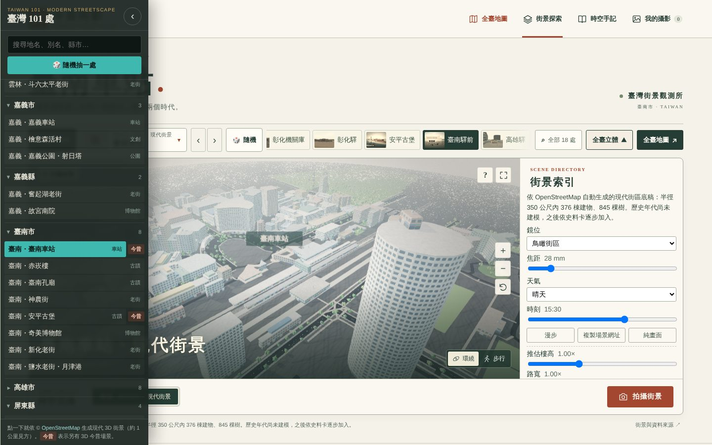
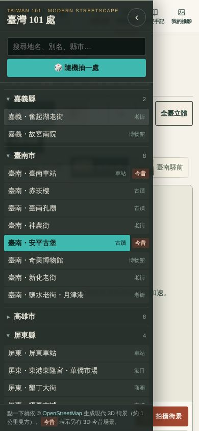

# 全臺 101 處現代街景清單

使用者看到どこでもロケハン左側有「臺灣 101」選單（依縣市分組，點一下就載入那裡的 3D 街景），希望本站也有。做法和它一樣：**先列一份地點清單，部署時預先把每個地點的 OSM 街區下載好放在本站，點哪裡就直接載入**。資料全部自己從 OpenStreetMap 下載，沒有使用どこでもロケハン的資料（它的條款也禁止再配布，見 `docs/streetscape.md`）。

## 1. 清單：`public/data/places-101.json`

- 101 處，涵蓋全部 22 個縣市：臺北市 17、新北市 9、臺中市與臺南市、高雄市各 7–8，其餘縣市 2–4，離島（澎湖、金門、馬祖）各 2–3。以車站、老街、古蹟、廟宇、地標、夜市、港口為主，因為現代街景是依 OSM 建物生成，市街比山林好看。
- 每筆：`id`（當檔名，小寫英數與連字號）、`name`、`city`、`district`、`kind`、`lat`、`lng`、`aliases`（搜尋用）。
- **座標核對**：2026-11-28 在使用者瀏覽器逐筆用 OSM Nominatim 查地名，與初稿相差超過 200 公尺的改用 Nominatim 結果（例如板橋車站初稿差 1.8 公里）。查錯同名地點的（中壢、南寮、水頭、東隆宮…）用更精確的地名重查。
- 與今昔地景（`scene-registry.json`）是同一地點的共用 id 與座標：`taipei-station`、`taichung-station`、`changhua-station`、`hsinchu-station`、`chiayi-station`、`tainan-station`、`anping-zeelandia`、`kaohsiung-station`、`hualien-railway`、`taitung-old-station`。清單上這些項目旁有「今昔」捷徑（已上線的才顯示）。
- 測試 `tests/places.test.mjs` 檢查：101 筆、id 不重複、座標在臺灣、22 縣市都有、彼此至少相隔 400 公尺（避免重複下載同一塊）、與今昔地景同 id 者座標相差 300 公尺內。

**新增或換掉地點**：改 `places-101.json` 一筆即可（清單名稱寫死 101 的地方只有測試與文件；數量變了改測試）。

## 2. 介面：`src/shared/scene-switcher.js`、`places.js`

- 景點列最左邊多一顆「☰ 臺灣 101」：打開左側抽屜清單，依縣市分組（臺北市優先，其餘北→中→南→東→離島），可搜尋（台／臺通用、別名、多個詞），目前地點反白。開合狀態記在 localStorage，換地點後維持；第一次進到 101 清單的地點且螢幕寬於 1100 px 時自動展開。
- 「🎲 隨機」按鈕（景點列與抽屜各一顆）：從 101 處隨機抽一處（不會抽到目前這處），等同 worldgacha 的玩法。
- 在 101 清單的地點上，景點列的「‹ ›」沿著 101 清單走。
- 景點目錄（Ctrl＋K）底部有連結可切到 101 清單。
- 點選開 `./?place=osm&id=<id>`；現代街景與全臺立體地景（`?place=tw&id=`）的 id 都先查 101 清單、再查今昔地景（`findPlaceById`）。

## 3. 預先下載：`scripts/bake-osm.mjs`＋`.github/workflows/deploy.yml`

- 下載對象：101 處＋今昔地景中有座標、未上線的（同 id 只下載一次），每處半徑 500 公尺（約 1 公里見方），存 `public/data/osm/<id>.json`。
- **容量**：每處 50 KB（郊區）到約 1 MB（臺北市區），估計 101 處合計 20–50 MB，遠低於 GitHub Pages 的 1 GB 網站上限；部署記錄最後會印出 `du -sh` 實際大小。
- **時間**：Overpass 每處約 30–60 秒，101 處第一次全部下載約 60–80 分鐘。所以改成**累積式**：資料夾存在 Actions 快取，每次部署只補缺的與超過 30 天的，預設每次最多 20 分鐘，跑不完留到下次部署。想一次補齊：到 Actions 手動執行「部署到 GitHub Pages」，`bake_minutes` 填 90。
- 還沒下載到的地點照樣能開：瀏覽器會即時向 Overpass 查詢（約 40 秒，結果快取 7 天）。
- 指令：`npm run bake-osm`（全部）、`npm run bake-osm -- <id> …`（指定）、`--budget=秒數`、`--max-age=天數`。

## 4. 出處

清單座標與街景都來自 © OpenStreetMap contributors（ODbL），抽屜底部、現代街景的「資料來源」都有標示。

## 5. 之後可以做

- 每處加預設鏡位（目前都用現代街景的「鳥瞰街區」）。
- 雲端容器連不到 Overpass，無法在 PR 階段預覽 101 處的實際街景；合併後要在使用者瀏覽器抽幾處確認（尤其山區的奮起湖、太魯閣，建物少，畫面會比較空）。
- 清單也可以出現在全臺地圖（`map.html`）的圖層上。
