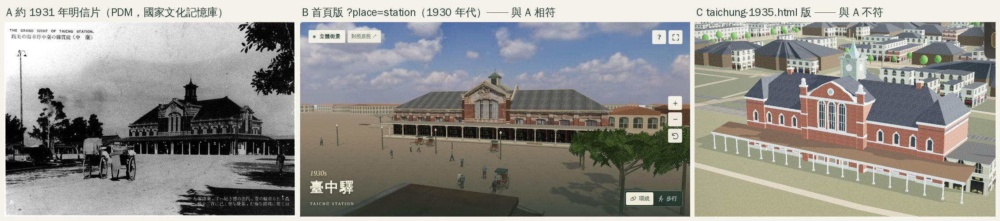

# 場景盤點與統一進度

更新：2026-11-28。盤點對象：首頁框架的臺中（車站、綠川、第一市場）、彰化（車站、扇形車庫）、臺北五代、高雄、臺南，以及獨立頁面 `taichung-1935.html`、`yuanshan.html`、`map.html`。

## 1. 臺中車站兩個版本：哪一版畫錯

比對依據是 repo 內唯一一張可公開的臺中驛舊照：`public/archive-station.jpg`，約 1931 年明信片〈縱貫線の臺中停車場の美觀〉，國家文化記憶庫，PDM 公眾領域（上圖 A）。

| 特徵 | 舊照 A | 首頁版 B（`?place=station`，`public/landmark.js`） | 1935 版 C（`taichung-1935.html`，`station1917.glb`／`src/builders/station.js`） |
|---|---|---|---|
| 屋脊上的塔 | 小型八角燈籠塔，屋頂外翻，看不到鐘面 | 小型燈籠塔，相符 | **方形鐘塔加綠色尖頂，有大鐘面**，不符 |
| 中央山牆 | 一扇通高的大拱窗，山牆頂有紋飾 | 大拱窗分格，山牆紋飾，相符 | **三扇細長拱窗**加圓窗，不符 |
| 主屋頂 | 一整片高聳寄棟屋頂，兩端各有山牆凸出 | 相符 | 兩翼各自寄棟、低矮端棟，不符 |
| 正面門廊 | 粗柱、深色，一層通長 | 相符 | 有門廊，但為細白柱、淺色長簷，比例偏細 |
| 正面朝向 | 面向站前廣場 | 相符 | 相符 |

**判斷：1935 版（`taichung-1935.html`）的站房畫錯**，主要是塔與中央山牆。首頁版 B 與舊照吻合。

我沒有刪除或改動 1935 版，等你確認。1935 版的獨特功能（0–24 時太陽、晴雨霧天氣、街寬與樓層編輯、存成拍攝場景）在首頁框架還沒有，所以建議的處理是：

1. 先把 1935 版的天氣、時刻功能移植到首頁框架的臺中場景（共用面板已預留「天氣」「時刻」欄位，引擎支援後自動出現）。
2. 移植完成後，`taichung-1935.html` 與 `#era=1935…` 舊網址轉到 `?place=station&era=past`，從地圖與 registry 移除 `taichung-1935` 這一筆。
3. `public/models/station1917.glb`、`tools/blender/station1917.py`、`src/builders/station.js` 隨之退場，或依舊照 A 重做後保留。

## 2. 統一前的差異

| 場景 | 介面 | 年代 | 鏡位 | 漫步 | 天氣／時刻 | 今昔並排 | 分享狀態 | 依據表 | 光影 |
|---|---|---|---|---|---|---|---|---|---|
| 臺中三處、彰化兩處、高雄 | 首頁框架 | 昔／今 2 鍵 | 臺中車站 4 個按鈕，其餘只有起點 | 有（方向鍵按鈕） | 無（工坊只有日間／清晨／斜陽） | 無 | 只有地點與騎樓 | 無，只有時空手記 | 無色調映射、固定天空照片、無調色 |
| 臺北 | 首頁框架 | 昔／今＋側欄下拉 5 代 | 2 個按鈕 | 有 | 無 | 無（另有影像對照頁） | 地點＋代數 | 只有每代一行 | 同上 |
| 臺南 | 首頁框架＋自製側欄 | 5 年代列 | 6 鏡位下拉＋焦距 | 有 | 有 | 有 | 年代、天氣、時刻、相機 | 有（A/B/C） | ACES、Sky、PMREM、年代調色 |
| 圓山 | **獨立全螢幕深色介面** | 4 節點時間軸 | 6 鏡位按鈕 | 無 | 有＋時代氛圍、膠彩筆觸 | 無 | 年代、時刻、天氣 | 無 | ACES、後製、膠彩濾鏡 |
| 臺中 1935 | **另一套全螢幕深色介面** | 1935／今 | 9 景點 | 有 | 有 | 無 | 年代、時刻、天氣 | 無 | 自有環境光 |
| 全臺地圖 | 地圖首頁 | 時間軸篩選 | — | — | — | — | 有 | registry 可信度 | — |

## 3. 本輪統一後

所有 3D 場景（臺中 1935 除外）都在首頁框架 `?place=` 裡開啟，側欄與底列是同一組共用面板（`src/shared/`）。

| 場景 | 年代列 | 鏡位 | 焦距 | 漫步 | 天氣／時刻 | 今昔並排 | 分享（含相機） | 依據表 | 純畫面 |
|---|---|---|---|---|---|---|---|---|---|
| 臺中車站 | 2 | 5（站前廣場、高架站入口、舊站近看、1930 年代騎樓、鳥瞰） | ✓ | ✓ | 待移植 | ✓ | ✓ | ✓ | ✓ |
| 綠川、第一市場、彰化、扇形車庫 | 2 | 3（起始、鳥瞰、人眼） | ✓ | ✓ | 待移植 | ✓ | ✓ | ✓ | ✓ |
| 臺北 | 5 | 4（近看站房、站區全景、鳥瞰、人眼） | ✓ | ✓ | 待移植 | ✓ | ✓ | ✓ | ✓ |
| 高雄 | 2 | 4（站前、近看帝冠站房、俯瞰、人眼） | ✓ | ✓ | 待移植 | ✓ | ✓ | ✓ | ✓ |
| 臺南 | 5 | 6 | ✓ | ✓ | ✓ | ✓ | ✓ | ✓ | ✓ |
| 圓山 | 4 | 6 | ✓ | 待做 | ✓＋氛圍、筆觸、舊橋殘影、標註、環繞 | ✓ | ✓ | ✓（新增） | ✓ |

- `yuanshan.html`、`tainan.html` 都改成轉址頁，舊參數照帶。臺北的街景索引多了「圓山・劍潭」。
- 首頁原有場景的舊側欄按鈕（車站四鏡位、臺北五代下拉、站區全景／近看）收進共用面板，元素仍留在頁面上供 `app.js` 使用。

## 4. 還沒統一的地方（下一步）

1. **光影**：`public/app.js` 場景沒有色調映射、年代調色、時刻與天氣。要依 `docs/art-direction.md` 第 3 節補上，可直接沿用臺南的 Sky＋太陽計算＋`post.js`。
2. **兩份 three.js**：`app.js` 用 `public/three.min.js`（r150–159 舊版 UMD），臺南與圓山用 npm 的 three r187。臺南、圓山頁面目前兩份都會下載。長期應把 `app.js` 改成 ES module。
3. **鏡位數**：首頁原有場景只有 3–5 個鏡位，目標六個，需要逐一取景。
4. **圓山漫步**：地形高度函式 `hAt` 已有，可加人眼漫步。
5. **臺中 1935**：見第 1 節，等你決定。
6. **其他景點**：先依 `docs/source-cards.md` 做平面圖文整理，再進 3D。
